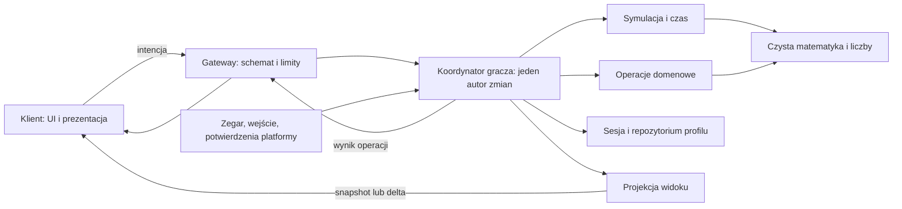

# Podział modułów i kontrakt komunikacji serwer–klient

> **Aktualna decyzja użytkownika — 28.10.2026 (R):** RCB zależne od liczby biegnących kur zostało usunięte. Dochód korzysta ze stałego mnożnika wynikającego z badań, niezależnego od wylęgu i `runningCount`; działa on również w rozliczeniu away. Grupy kur, rezerwacje miejsc i dotarcia pozostają logiką populacji. Nazwy `activeRCB`/`onscreenChickenMult*` w kodzie i zapisach są historyczne. Aktualny kontrakt: [31 §3](31_research_hatching_rcb_and_new_account.md#3-stały-mnożnik-dochodu-i-przejścia-populacji). Starsze opisy aktywnego RCB w historii dostaw nie są bieżącym wymaganiem.

> **Decyzja użytkownika 28.10.2026 (R): czasowy podwajacz dochodu i badanie `video_doubler_time` („Dłuższe Wzmocnienia”) zostały usunięte z gry.** Dawne terminy/poziomy w profilach są zachowane wyłącznie dla zgodności i nie dają efektu ani możliwości zakupu. Poniższe wcześniejsze zasady VD, jego darmowej aktywacji i odnawiania są historyczne. Osobny pass `double_cash` (2× Cash), boosty oraz zasady bonusowych prezentów pozostają poza tą zmianą. [Zakres i testy](workflow/remove_timed_doubler_2026_10_28.md).

23.10.2026. **P — propozycja techniczna, bez implementacji.** Uzupełnia [27 — liczby, czas i stan](27_numbers_time_and_player_state_contract.md), nie zastępuje jego typów, resetów ani D07. Nazwy modułów, wiadomości i pól są propozycjami. Reguły R rozstrzygają [CURRENT_SPEC](CURRENT_SPEC.md) i dokumenty [22](22_gameplay_rules_for_approval.md), [24](24_doubler_and_bonus_gift_acceptance_review.md), [25](25_approved_product_structure.md), [26](26_approved_launch_scope_and_pro_availability.md).

Nie ustala bibliotek, fizycznej liczby plików, produktów platformowych, cen, slotów lub bilansu. Nie tworzy remotes, konfiguracji, kodu Luau ani środowiska Studio. Nazwy funkcji są opisem interfejsów logicznych, nie twierdzeniem o istniejących API.

## 1. Granice odpowiedzialności

Strzałki pokazują przepływ, nie przyzwolenie na omijanie właściciela stanu. Domain i Simulation zwracają kandydat stanu/efektu, nie zapisują profilu. Projection odczytuje wyłącznie spójny opublikowany stan. Komenda, tick, checkpoint offline i potwierdzenie zakupu przechodzą przez tego samego koordynatora gracza. Jedna sesja nie oznacza automatycznie braku wyścigu między dwoma wątkami.

## 2. Moduły serwera i ich kontrakty

| Moduł logiczny P | Wejście → wynik | Odpowiedzialność i zakazy |
|---|---|---|
| NumericCodec | Typy z 27 / tekst wire → zwalidowana wartość; wartość → tekst | BigAmount, Real64 i ExactUInt; jawne konwersje i jednostki. Bez odczytu platformy i cen, bez formatowania UI w stanie ekonomii. |
| CatalogRegistry | Wersja → niezmienny katalog i reguły dostępności | ID, ceny referencyjne, efekty, krzywe i przypięta wersja. Oddziela REFERENCE_ONLY od aktywnej konfiguracji. Brak automatycznej aktywacji całego JSON. |
| FarmMath | Jawny snapshot wejść, dt i katalog → wartości | Badania, sprzedaż/transport, FV, SE i warstwy efektów jako czyste obliczenia. FV nie zastępuje funkcji dochodu. Bez własnego zegara, RNG, sieci lub zapisu. |
| TimelineSimulation | Profil, start/cel czasu, historia i konfiguracja → kandydat stanu + cursor/checkpoint | Kolejność i siatka z 27; online/away, eventy, boosty, VD, IHR i księgowanie. Budżet techniczny przerywa pracę, nie obcina należnej produkcji. |
| PlayerCoordinator | Zdarzenie/komenda i aktualny profil → wynik, commit lub stan oczekiwania | Wyłączny autor zmian dla danego gracza; kolejkuje ticki i komendy, sprawdza sesję i powtórki, rozlicza stary odcinek, uruchamia domenę, zatwierdza spójny wynik. Bez bezpośredniej manipulacji UI. |
| FarmActions | Cel badania/kurnika/pojazdu/jaja lub prestiżu → plan zmiany | Cena, wymagania, właściwy reset, SE i materiał bazowy zgodnie z 27. Nie zapisuje ani samodzielnie nie przyznaje waluty. |
| PetActions | Wskazane UID, tier/target i aktywny profil → plan wyposażenia/łączenia | Spójność kopii, lock/wyposażenie, chroniony bazowy, gwarancja i premium. Bez automatycznej podmiany materiałów. Pozyskiwanie i liczby czekają na zatwierdzoną konfigurację. |
| RewardActions | ID uprawnionej nagrody/oferty lub próba harmonogramu → plan utworzenia/odbioru/rezerwacji | Wagi, konwersje, kalendarz/trofea, 2+1, stały wynik, prawa UTC i VD. Nie przyjmuje kwoty ani wyniku od klienta. |
| SessionRepository | Profil, token właściciela, wersja i operacja → potwierdzony commit / błąd / nieznany wynik | Trwałość, generacja sesji, migracje i odtwarzanie. Jedyny adapter do zapisu; nie oblicza cen, losów ani reguł produktu. Weryfikuje ID i własność również podczas zatwierdzania. |
| PlatformPurchaseAdapter | Potwierdzenie z zaufanego źródła platformy → wewnętrzna komenda do koordynatora | Oddziela passy od zakupów powtarzalnych, powiązuje zamówienie z potwierdzeniem. Komunikat klienta nie jest potwierdzeniem opłaty. Brak bezpośredniego przyznawania zasobów. |
| ViewProjector | Spójny stan + kontekst odbiorcy → dozwolony DTO | Prywatny widok własny i ograniczony widok publiczny; pochodne/ceny/wyposażenie/uprawnienia. Nie kopiuje profilu i nie zdradza historii operacji, sesji lub losowania. |
| NetworkGateway | Tożsamość połączenia + wiadomość → odrzucenie schematu / przekazanie komendy lub odczytu | Allowlista typów i pól, limity, kierunek, kontekst gracza. Bez ekonomii i własnych zapisów. Odpowiedź kieruje wyłącznie do właściwego odbiorcy. |

Podmoduły FarmMath mogą odpowiadać research, produkcji, FV, prestiżowi i rozkładom. Nie wymagamy odrębnego serwisu dla każdego wzoru. CatalogRegistry i historia eventów są jawnie wstrzykiwanymi, wersjonowanymi zależnościami. RNG jest zależnością serwerową koordynatora/operacji losowej; FarmMath może otrzymać ustalony draw jako wejście, ale nie tworzy własnego generatora.

Repozytorium nie może wywoływać sieci klienta ani wykonywać nowego losowania w ponawianej transformacji zapisu. Kandydat losu jest związany z operacją i przypiętymi wejściami; zmiana warunków nie uprawnia do rerollu. Rozstrzygnięcie właściciela i trwałego ID ma pierwszeństwo przed publikacją korzyści.

### 2.1. Wewnętrzna jednostka pracy

P: kontekst komendy obejmuje tożsamość gracza, bieżący token/generację sesji, profil, wersję konfiguracji/obliczeń, ustalony cel czasu i operationId. Kontekst nie trafia na klienta. Plan domenowy wskazuje preconditions, koszt, materiały, zmiany, znaczniki oraz wynik, a nie tylko listę zmian sald.

Koordynator rozdziela stan ostatnio utrwalony od późniejszej symulacji online w pamięci. Nie publikuje kandydatów z nieznanym wynikiem zapisu jako potwierdzonej korzyści. D07 nie wymaga zapisu każdej klatki, ale wynik nagrody/zakupu i postęp okresu muszą spełniać kontrakt trwałości. Polityka checkpointów i adapter zapisu pozostają zależnością techniczną, nie są tu zastępowane domyślnym interwałem.

## 3. Moduły klienta i wspólne definicje

| Obszar P | Rola |
|---|---|
| ClientTransport | Wysyła wiadomości, koreluje requestId, odbiera statusy. Timeout nie tworzy nowej operacji ekonomicznej. |
| ClientStateStore | Przechowuje projekcję serwera według streamId/viewSeq; wykrywa lukę, inicjuje resync i odrzuca stare aktualizacje. Bez własnego naliczania salda. |
| IntentControllers | Obsługują wejście: badanie, wylęg, wybór UID, odbiór, prestiż; oczekiwanie i jawne potwierdzenie oferty. Nie zmieniają danych autorytatywnych. |
| FarmPresentation / UI | Modele, animacje, dźwięk, liczby i lokalizowane komunikaty. Liczba modeli kur nie jest populacją ekonomii. |
| SharedProtocol | Schematy DTO, wersja protokołu, kody statusów, ID katalogowe i codec wiadomości. Brak tokenów sesji, kluczy, ledgeru zakupów i uprawnień do zapisu. |

Kod autorytatywny i konfiguracja serwera pozostają w obszarze serwerowym. Klient może znać ceny lub wzory potrzebne do podglądu; ich ukrywanie nie jest zabezpieczeniem. Kontrola serwera zawsze ponownie używa własnej konfiguracji. Wizualne przewidywanie ruchu, kliknięcia i odliczania jest dozwolone, ale nie potwierdza nagrody i nie odblokowuje kolejnego zakupu.

To podział odpowiedzialności, nie wybrany framework replikacji lub układ gotowych plików. Fizyczne mapowanie na obiekty Studio i transport wymaga późniejszej realizacji.

## 4. Rodzaje wiadomości i wersjonowanie

Rekomendacja P: logicznie asynchroniczne komendy i odpowiedzi; nie blokować przepływu UI długim wywołaniem oczekującym na cały offline, zapis lub płatność. Nie wiązać trwałości operacji z czasem życia połączenia. Konkretne mechanizmy transportu i limity platformy należy zweryfikować przy wyborze adaptera.

| Kanał logiczny | Kierunek | Treść |
|---|---|---|
| Bootstrap / RefreshState | Klient → serwer; serwer → klient | Wersja protokołu, stan ładowania i spójny snapshot. Odczyt nie wywołuje samodzielnie nowej nagrody ani kolejnego rozliczenia offline. |
| QuoteRequest / QuoteView | Klient → serwer; serwer → klient | Cele, materiały i wybrany wariant → podgląd z quoteId, zaobserwowaną wersją i warunkami. Nie pobiera opłaty, nie rezerwuje oferty i nie losuje wyniku łączenia. |
| Command | Klient → serwer | Intencja ekonomiczna z operationId, oczekiwaną commitRevision i dozwolonymi argumentami. |
| CommandResult / OperationStatus | Serwer → klient; klient może pytać o własny ID | Wynik trwały, odrzucenie albo stan oczekiwania/niepewności. Nie jest pełnym profilem. |
| StateSnapshot / StateDelta | Serwer → klient | Projekcja własna/publiczna, wersje i czas obserwacji. Nigdy arbitralny patch klienta do profilu. |
| HatchPress / HatchInput | Klient → serwer | Pojedyncze naciśnięcie albo start/refresh/stop przytrzymania; bez liczby nowych kur. Press i hold nie są równoważnymi prawami. |
| PresentationEvent | Serwer → klient | Opcjonalna animacja potwierdzonego zdarzenia z jego ID. Nie stanowi drugiego źródła wypłaty. |

protocolVersion dotyczy formatu wiadomości, schemaVersion profilu, numericCodecVersion kodowania, calculationVersion arytmetyki, configRevision konfiguracji. Nie używać jednego numeru do wszystkich tych ról. Nieobsługiwana wersja protokołu zatrzymuje mutacje z czytelnym statusem; nie zgadujemy dekodowania.

### 4.1. Koperta komendy

| Pole | Znaczenie i walidacja |
|---|---|
| protocolVersion | Obsługiwana wersja formatu. |
| requestId | ID bieżącej próby transportowej, korelacja odpowiedzi; po ponownym połączeniu może być nowe. |
| operationId | Stały ID tej samej logicznej operacji; powtórka po timeout nie zmienia go. |
| kind | Jedna z dopuszczonych nazw komend. Nie nazwa funkcji do dynamicznego wywołania. |
| expectedRevision | ExactUInt z ostatniej znanej commitRevision; warunek nowej komendy, nie powód odrzucenia istniejącego replay. |
| args | Wyłącznie schemat właściwy dla kind; ID celów i jawny wybór, bez własnych kwot/wyników. |

Serwer bierze playerId z kontekstu połączenia, nie z args. Token/generacja sesji z 27 nigdy nie przychodzi od klienta. requestId i operationId nie są poświadczeniem uprawnień. P: identyfikatory wiadomości są niepustym tekstem ASCII o ograniczonej długości; szczegółowe limity bajtów i kolejek ustala adapter protokołu przed uruchomieniem, bez kopiowania przykładowych stawek z ECC.

Klucz trwałej deduplikacji pozostaje (playerId,operationId). Kanoniczne argumenty obejmują kind, cele, wybrany materiał, finansowanie i quoteId/orderId, jeśli występują. requestId, expectedRevision i bieżący viewSeq są metadanymi transportu/preconditions, nie nową treścią ekonomiczną. Serwer utrwala znaczenie pierwotnych argumentów. Nie zmieniać po timeout materiałów, celu ani waluty pod tym samym operationId.

### 4.2. Dozwolone intencje — schematy P

| Grupa | Intencja i minimalne argumenty | Serwer ustala |
|---|---|---|
| Badania | BuyResearch: researchId, quoteId, tryb single; tryb max tylko z prawem Buy MAX | Poziom, bramka, cena i możliwy zakres zakupu. Podgląd max wiąże także liczbę poziomów i łączny koszt; brak dowolnego klientowskiego count. |
| Infrastruktura | BuyHabitat: slotId, habitatId; BuyVehicle: slotId, vehicleId; BuyTrainCar: trainSlotId; BuySilo bez kwoty; każda z tych komend wymaga quoteId | Stan slotu, cenę zależną od egzemplarzy, długość pociągu, wolne miejsce i uprawnienia. |
| Postęp | ChangeEgg: targetEggId; Prestige: potwierdzona intencja, bez liczby SE | FV, dostępność, naliczenie i całą macierz resetu. |
| Pety | EquipPet: petUid, slotId; UnequipPet: slotId; SetPetLock: petUid, boolean; FusePets: baseUid, materialUids, targetVariant, quoteId | Własność, zgodność, lock/wyposażenie, szansę, gwarancję i zużycie. Brak automatycznej podmiany listy. |
| Boosty i VD | ActivateBoost: boostId; ActivateDoubler: quoteId, financing | Sztuki, dostępność/sloty, czas, prawo UTC i cenę. Pro nie jest drugim mnożnikiem VD. |
| Nagrody | ClaimCalendar bez dowolnego numeru nagrody; ClaimTrophy: eggId, thresholdId; ClaimOffer: offerId, quoteId, financing wyłącznie free/Diamenty (GE); DismissOffer: offerId | Następną należną nagrodę, znaczniki, stały wynik oferty i rezerwacje. Robux rozpoczyna PreparePurchase, nie ClaimOffer. |
| Dron | ClaimDrone: droneInstanceId | Czy serwer utworzył uprawnionego drona, jego stan, kwalifikację trafienia i jeden wynik. Brak kwoty, typu elity lub znacznika czasu od klienta. |
| Zakupy platformowe | PreparePurchase: productId, quoteId i kontekst celu; dla prezentu obowiązkowo offerId oraz financing=Robux; później wyłącznie podgląd/status zamówienia | Dostępność, rzeczywistą korzyść, orderId i związanie z potwierdzeniem platformy. Brak komendy GrantPurchase. |

financing to wybór dopuszczonego wariantu, nie zgoda na dowolną cenę. Piggy i inkubacja nie otrzymują aktywnego handlera bez zatwierdzonych parametrów i włączonego zakresu. Auto-Hatch/VIP, handel, ekspedycje i kontrakty kooperacyjne nie stają się dostępne przez istnienie ogólnego Command.

### 4.3. Wylęg ciągły i interakcje

Uzupełnienie P z [31](31_research_hatching_rcb_and_new_account.md): HatchPress zgłasza jedną próbę ręcznego wypuszczenia kury; serwer sprawdza zapas i miejsce. HatchInput utrzymuje wyłącznie intencję przytrzymania, a powtarzanie wymaga właściwego holdRate; przy zerowym Epic i braku innych efektów wynosi on 0. Start/heartbeat nie uruchamia domyślnego automatu 3/s. Oba rodzaje wejścia mają wspólną kolejność/deduplikację w strumieniu połączenia, bez klientowskiego count i trwałego zakupu dla każdego press.

P: ręczny wylęg używa stanów start/stop oraz ograniczonej czasowo intencji odświeżanej przez klienta. Serwer sam ustala tempo, zapas, refill i pojemność, a rozliczenie przechodzi przez koordynatora. Brak odświeżenia, rozłączenie, reset lub utrata sesji kończą intencję; pojedynczy spóźniony start nie może utrzymywać jej bez końca. Czas ważności i częstotliwość transportu są techniczną zależnością adaptera, nie zmianą tempa wylęgu lub płatnym Auto-Hatch.

Ten kanał ma własny numer porządkowy w strumieniu połączenia; duplikaty/stare inputy nie dodają kur. Nie zapisujemy osobnej ekonomicznej transakcji dla każdego heartbeat. D07 obowiązuje dla stanu wynikowego i checkpointów, a klient nie może odtworzyć wylęgu za offline pakietem dawnych wejść. Start/stop nie zastępują czasu serwera.

Jeśli interakcja wymaga położenia lub widocznego obiektu, klient podaje ID celu. Serwer sprawdza właściwy stan gracza/obiektu i warunki zleconego systemu. Nie wprowadzamy tu nowych odległości ani cooldownów produktu. Zniknięcie dekoracyjnego modelu nie usuwa potwierdzonego przedmiotu lub wyniku operacji.

## 5. Przetwarzanie nowej komendy i powtórki

1. Gateway weryfikuje kierunek, kontekst nadawcy, wersję, typy, rozmiar i allowlistę. Ogranicza koszt parsowania oraz kolejkę. Nieprawidłowy klient nie powoduje odczytu całego archiwum operacji lub dowolnego klucza zapisu.
2. Koordynator sprawdza własność sesji oraz istniejący operationId i znaczenie argumentów. Powtórka z tymi samymi argumentami dostaje zapisany wynik przed kontrolą expectedRevision lub wygaśnięcia podglądu; zmieniona treść to konflikt ID.
3. Dla nowej operacji, gdy trwa ładowanie/rozliczanie offline albo nieznana sprzeczna mutacja, nie przyjmuje wykonania i zwraca admission=NOT_ACCEPTED z SESSION_NOT_READY lub OPERATION_BLOCKED. Nie jest to PENDING ani terminalny rekord domenowy. Nie oblicza ceny na częściowym profilu. Dopuszczoną nową operację weryfikuje względem expectedRevision, po czym rozlicza stary odcinek czasu i ponownie waliduje warunki na świeżym stanie. Jeśli to rozliczenie zmieniło trwałą bazę i precondition nie obowiązuje, odświeża widok/podgląd zamiast stosować starą zgodę na zakup.
4. Moduł domenowy przygotowuje plan; koordynator łączy go ze stanem czasu, kosztami, ID i wynikiem. Repozytorium ponownie sprawdza token, wersję i deduplikację podczas zatwierdzania. W jego ponowieniu nie wywołuje się platformy, losowania lub UI.
5. Potwierdzony commit publikuje wynik operacji i spójną projekcję. Nieznany wynik pozostaje UNKNOWN; UI nie zakłada odrzucenia ani nie losuje nowego ID. Odczyt statusu jest ograniczony do własnej operacji i nie tworzy nowego przyznania nagrody.

Rozliczenie starego odcinka i nowa akcja mogą być jednym kandydatem do wspólnego commit; expectedRevision porównuje się wtedy z wersją trwałej bazy, nie z wewnętrznymi fazami obliczenia. Sam wzrost w pamięci lub nowy viewSeq nie oznacza STALE_REVISION. Ponowna walidacja obejmuje natomiast aktualny koszt i podgląd; odrębnie zatwierdzony checkpoint zmieniający trwałą bazę wymaga właściwego odświeżenia precondition.

P: odczyty UI obsługuje projekcja w pamięci; nie wykonują bezpośrednio nowego zapisu lub nowego rozliczenia offline. Ewentualne rozstrzygnięcie nieznanego wyniku wykonuje wewnętrzny proces właściciela sesji, a zapytanie zwraca jego aktualny status. Nie odblokowywać nowej operacji kolidującej z nierozstrzygniętym kosztem/rezerwacją.

Zapytanie o brakujący ID nie jest automatycznie NOT_APPLIED: przy wcześniejszym timeout, utracie sesji lub niepełnym odtworzeniu status pozostaje nierozstrzygnięty do wykluczenia trwającej próby. Bezpieczna retencja z 27 ma umożliwiać rozpoznanie utrwalonych powtórek; nie maskować usuniętego rekordu jako nowej operacji.

### 5.1. Wynik operacji i błędy

Proponowana koperta wyniku zawiera protocolVersion, requestId, operationId, kind, status, resultRevision (jeżeli utrwalono), currentCommitRevision, streamId, serverObservedAt oraz dozwolony result lub errorCode. Nie ma jednego pola success=false, które jednocześnie oznacza brak środków i nieznany zapis.

| status P | Trwałość / znaczenie | Zachowanie klienta |
|---|---|---|
| APPLIED | Potwierdzono trwały wynik, koszt i znaczniki | Zakończ oczekiwanie. Nie odtwarzaj samodzielnie salda z animacji. |
| REPLAYED | Zwrócono ten sam utrwalony wynik z wcześniejszej operacji | Tak samo jak dla pierwotnego wyniku; replay może dotyczyć także utrwalonego odrzucenia, więc result zawiera pierwotny terminalStatus. |
| REJECTED | Terminalny wynik reguł/warunków danej operacji | Pokaż kod i podgląd. Nowa świadoma próba po zmianie warunków ma nowy operationId. |
| NOT_APPLIED | Istnieje pewność, że transformację anulowano lub nie doszło do wykonania i nie ma innego trwającego wykonania tej operacji | Bez efektu ekonomicznego; ponowienie zleca się jawnie według reguł poniżej. Sam brak rekordu lub timeout nie dowodzi tego statusu. |
| PENDING | Wykonanie przyjęto i istnieje śledzona praca lub zależne przygotowanie z odpowiedzialnym właścicielem; nie potwierdza kosztu ani korzyści | Ograniczone sprawdzanie tego samego ID. Właściciel doprowadza do wyniku terminalnego lub UNKNOWN; przyjęcie do pamięci nie gwarantuje trwałej kolejki. |
| UNKNOWN | Wynik zapisu/płatności jest nierozstrzygnięty | Zachowaj ID i rezerwację; status/odtworzenie, bez nowego zakupu i bez automatycznego anulowania. |

Przykładowe kody: INVALID_REQUEST, UNSUPPORTED_PROTOCOL, SESSION_NOT_READY, OPERATION_BLOCKED, SESSION_LOST, STALE_REVISION, OPERATION_ID_CONFLICT, INSUFFICIENT_CASH, INSUFFICIENT_GE, PET_LOCKED, RECIPE_MISMATCH, QUOTE_CHANGED, OFFER_RESERVED, FEATURE_UNAVAILABLE, TECHNICAL_RANGE_ERROR, RATE_LIMITED. Kod i klucz lokalizacji nie zawierają stack trace, tokenów lub surowej odpowiedzi zapisu. Nie tłumaczyć powtórki udanej operacji jako błędu TRANSACTION_ALREADY_PROCESSED.

Błędy przed dopuszczeniem do domeny, np. zły schemat lub ograniczenie transportu, nie tworzą fikcyjnego trwałego rekordu ekonomii; odpowiedź zawiera etap admission i informację, że nie przyjęto nowego wykonania w tej próbie. Nie jest to dowód, że wcześniejsza próba tego ID się nie powiodła. Przy braku pewności klient sprawdza status pierwotnej operacji. Terminalny rekord domenowy i transient transportowy błąd muszą być rozróżnione.

P: odpowiedź admission=NOT_ACCEPTED nie ma terminalStatus operacji. Po gotowości sesji klient może jawnie ponowić te same argumenty z tym samym operationId, aktualizując requestId i expectedRevision; nie zmienia pod tym ID quoteId lub finansowania. Jeśli podgląd wymaga zmiany, najpierw trzeba rozstrzygnąć poprzednią próbę, a zmieniona intencja otrzymuje nowy ID. Wcześniejszy timeout wymaga najpierw sprawdzenia statusu, nie założenia, że NOT_ACCEPTED z późniejszej próby anuluje poprzednią.

Po restarcie lub utracie kolejki brak śledzonej pracy nie może pozostawić wiecznego PENDING. Uprawniony właściciel odtwarza trwały wynik/zamówienie albo przechodzi przez UNKNOWN i sprawdza zapis oraz wyklucza starego autora. Dopiero pewność braku efektu i trwającego wykonania pozwala zwrócić NOT_APPLIED. Po tym statusie klient może jawnie ponowić niezmienioną intencję z tym samym ID; przyjęcie nadal atomowo sprawdza deduplikację. Nowy ID jest dozwolony dopiero po takim rozstrzygnięciu, gdy gracz składa nową intencję. Odczyt statusu sam nie uruchamia odrzuconej przy admission komendy. Nie wymaga to trwałej kolejki wszystkich komend.

## 6. Snapshot, delta i odtwarzanie widoku

commitRevision jest wartością meta.revision z 27, zmienianą przy trwałym zatwierdzeniu. viewSeq to odrębny licznik kolejnych projekcji w jednym streamId; może rosnąć przy aktualizacji online bez zapisu każdej klatki. Zmiana viewSeq nie unieważnia sama w sobie expectedRevision. Cache klienta nigdy nie podaje viewSeq jako wersji profilu.

P: wejście/reconnect/resync nadaje nowy streamId. Snapshot zawiera viewSeq, commitRevision, schema protokołu widoku, configRevision, calculationVersion, numericCodecVersion, serverObservedAt i kompletny dozwolony widok dla odbiorcy. Nowy strumień w tym samym połączeniu zastępuje stary po potwierdzonym bootstrapie; pakiety starego strumienia nie mogą go nadpisać. Handshake/requestId rozróżnia spóźnioną odpowiedź bootstrapu od bieżącej.

Delta zawiera streamId, baseViewSeq, viewSeq, commitRevision, wersje i zmianę dozwolonych pól widoku, w tym jawne usunięcia. Klient stosuje ją tylko do dokładnego baseViewSeq. Starsze/duplikowane pakiety ignoruje; luka, niezgodny codec lub wersja widoku wymaga pełnego snapshotu. Nie stosować części delty, a potem zgadywać brakującej reszty. Resync nie resetuje operationId ani zapisanych rezerwacji.

CommandResult nie wymaga nadejścia przed deltą lub po niej. Służy do rozstrzygnięcia danej operacji, a stan bierze się ze spójnego strumienia. Replay starego sukcesu nie cofa nowego widoku do resultRevision. Animacje mają osobne ID zdarzeń i są deduplikowane; utrata animacji nie gubi nagrody, powtórzenie nie przyznaje jej ponownie.

### 6.1. Dozwolone projekcje

- **Własny widok:** własne salda i potrzebne statystyki, farmę/infrastrukturę/badania, wyposażenie i ekwipunek, widoczne boosty/VD, oferty z ustaloną zawartością, prawa UTC i postęp kalendarza/trofeów, faktyczne korzyści passów. Format liczbowy zgodny z 27: ExactUInt jako kanoniczny tekst, kwoty/Real64 z codec round-trip, Instant w ms, Duration w sekundach. Klient lokalizuje i skraca dopiero do prezentacji.
- **Widok publiczny innej farmy:** tylko jawnie dozwolone informacje potrzebne do sceny, np. typy widocznych budynków, kosmetyka i zagregowane dane prezentacji. Brak sald GE, prywatnych UID ekwipunku, wyników przyszłych losów i operacji. Konkretna lista publicznych pól jest częścią schematu widoku; domyślnie pole nieujawnione jest pominięte.
- **Tylko serwer:** ownership/sessionToken, receipt ID i pełny ledger zakupów, kandydaci losowania/seedy, hash argumentów, checkpointy wewnętrzne, historia potrzebna tylko do naliczenia i pełny profil. Wynik operacji ujawnia tylko dane potrzebne jej właścicielowi, nie surowy rekord zapisu.

Snapshot opisuje stan loading/offlineSettling/ready/sessionLost. W loading i offlineSettling UI może pokazywać postęp, lecz nie udostępnia zakupów na niepełnym saldzie. Po sessionLost zatrzymuje intencję wylęgu i nowe komendy; nie wysyła bufora dawnych działań jako należnych zakupów. Zapisane operacje rozstrzyga serwer przy bezpiecznym wznowieniu.

## 7. Podglądy, finansowanie i potwierdzenia platformy

P: quoteId wiąże serwerowy podgląd z celem, argumentami, wersją konfiguracji i warunkami. Podgląd pokazuje konkretną zawartość, koszt i finansowanie; dla łączenia także materiały, szansę i stan gwarancji. Nie rezerwuje automatycznie waluty ani nie jest wynikiem losowania. Utrwalony wynik istniejącej oferty pozostaje niezmienny po zmianie jaja/eventu.

Podgląd jest obowiązkowy dla BuyResearch (single/max), wszystkich zakupów infrastruktury, FusePets, ActivateDoubler, ClaimOffer (również free) i PreparePurchase. quoteId jest odwołaniem do wyceny serwera, nie ceną od klienta. expectedRevision go nie zastępuje: czas/event lub konfiguracja mogą zmienić koszt bez zmiany commitRevision. Dla Buy MAX świeża walidacja porównuje także uzgodniony zakres poziomów, zamiast cicho wydać więcej po wzroście salda. Brak lub niewłaściwy quoteId blokuje wykonanie przed obciążeniem; podgląd nie pobiera kosztu samym wyświetleniem.

Przy nowej operacji zmieniony koszt, materiały, prawo UTC, kwalifikacja premium lub warunki podglądu powodują QUOTE_CHANGED i odświeżenie. Nie przełączać darmowego użycia na płatne ani GE na Robux bez świadomego potwierdzenia. Powtórzenie już rozstrzygniętego ID nadal zwraca stary wynik. Dopuszczalny okres ważności podglądu jest parametrem technicznym adaptera; nie dodaje automatycznego wygaśnięcia trwałej oferty D05.

Zamówienie Robux powstaje z ustaloną korzyścią i rezerwacją przed uruchomieniem płatności. Klient może otworzyć interfejs płatności lub zgłosić jego zamknięcie, ale nie może wywołać uznania korzyści, anulowania nieznanego zakupu ani zwolnienia rezerwacji. Zaufane potwierdzenie trafia do PlatformPurchaseAdapter i koordynatora, także po rozłączeniu. Nie wybieramy tu sposobu mapowania rzeczywistych produktów lub API; jego poprawność wymaga późniejszego zadania.

### 7.1. Jedna ścieżka prezentu za Robux — P

1. QuoteRequest wskazuje offerId i financing=Robux. Serwer zwraca quoteId z konkretną zapisaną zawartością/ilością, ofertą produktu i ceną; podgląd nie rezerwuje prezentu.
2. Klient potwierdza przez PreparePurchase(productId, quoteId, offerId, financing=Robux) z operationId. Koordynator sprawdza świeży stan i podgląd, a następnie atomowo utrwala orderId, gracza, produkt, offerId, stałą korzyść, warunki płatności oraz rezerwację tej oferty i wynik przygotowania. Powtórzenie operationId zwraca ten sam orderId; nowe ID nie tworzy drugiego zamówienia dla zarezerwowanej oferty.
3. Dopiero potwierdzenie trwałego przygotowania pozwala otworzyć płatność. APPLIED/REPLAYED dla PreparePurchase potwierdza wyłącznie przygotowanie zamówienia, nie opłatę lub wypłatę prezentu. Stan płatności/realizacji jest osobnym statusem orderId; UNKNOWN zapisu przygotowania blokuje uruchomienie nowego zakupu do rozstrzygnięcia.
4. Zaufane potwierdzenie platformy jest wiązane przez adapter z tym samym zamówieniem, graczem i produktem. Koordynator atomowo zapisuje identyfikator potwierdzenia, wypłatę ustalonej korzyści, zużycie oferty i realizację zamówienia. Powtórka potwierdzenia nie wypłaca ponownie; odbiór nie wymaga kolejnego ClaimOffer. Do czasu rozstrzygnięcia niedozwolone są ClaimOffer, DismissOffer i drugi zakup tej oferty.
5. Zamknięcie UI, timeout lub rozłączenie nie zwalniają rezerwacji. Dopiero potwierdzony brak zakupu pozwala zamknąć zamówienie bez wypłaty i przywrócić zwykły odbiór; nieznany wynik zachowuje rezerwację. Późne potwierdzenie realizuje pierwotne opłacone zamówienie, bez pobierania GE lub zużycia nowego darmowego prawa UTC.

Dobór produktów i niezawodne powiązanie potwierdzeń z orderId pozostają zadaniem adaptera przed aktywacją tej ścieżki. Klientowski orderId ani komunikat o zamknięciu okna nie stanowią dowodu płatności lub jej braku. Nie wprowadza to nowej oferty produktu ani ceny.

Pass jest uprawnieniem, a zakup powtarzalny operacją z trwałym potwierdzeniem. Kwalifikacja +10 p.p. jest sprawdzana na serwerze oddzielnie od własności Pro; klient widzi rzeczywistą ofertę przed zakupem i nie otrzymuje automatycznego zamiennika. Opóźnione potwierdzenie zamówienia opłaconego przed północą nie zużywa darmowego prawa nowego dnia. Zmiana uprawnienia nie działa wstecz na nierozliczone offline poza zasadą effectiveAt z 27.

## 8. Bezpieczeństwo transportu i ograniczenie pracy

Walidacja obejmuje typy, skończoność liczb, zakres ID/slotów, długość tekstu, liczbę i unikalność materiałów, głębokość i rozmiar wiadomości oraz nieznane pola. Nie akceptować instancji lub dowolnych ścieżek do zmiany stanu. Ceny, wariant premium, czas, wynik losowy i saldo klienta nie są danymi do zatwierdzenia.

Limity rozdzielają wejście wylęgu, mutacje ekonomii, statusy i bootstrap. Powtórka znanego ID nie powinna uruchamiać ponownie symulacji, platformy lub pełnego zapisu. Kolejka i fan-out mają skończony budżet; przeciążenie zwraca jawny stan transportowy zamiast udawać sukces lub kasować przyjętą operację. Konkretne stawki wymagają pomiaru adaptera, nie są ceną lub balansem.

Narzędzia developerskie przyznające zasoby nie należą do protokołu produkcji. Nie wystarczy ukryć przycisku klienta: konfiguracja wydania nie rejestruje tych handlerów. Zwykłe logowanie diagnostyczne jest odrębną sprawą. Widoczność budynku czy brak klientowskiego modelu nie zastępuje walidacji uprawnienia i własności na serwerze.

## 9. Scenariusze akceptacyjne — NIE URUCHOMIONO

| Scenariusz | Oczekiwany rezultat |
|---|---|
| Klient przesyła cenę, typ elity, SE lub playerId innej osoby | Odrzucenie schematu/próby przekroczenia uprawnień, bez mutacji. |
| Dwa równoległe Command z tym samym operationId | Jeden koszt i wynik; drugi zwraca trwały rezultat lub PENDING/UNKNOWN do rozstrzygnięcia. |
| Timeout po zapisie, reconnect i nowe requestId z dawnym operationId | Replay wyniku bez nowego losowania, także przy starej expectedRevision. |
| Ten sam operationId z innymi materiałami albo celem | Konflikt ID, brak podmiany materiałów i nowego kosztu. |
| Delta przed CommandResult lub stary replay po nowszej delcie | Widok nie cofa się; animacja i nagroda nie dublują się. |
| Brakująca delta, zmiana streamId, spóźniony bootstrap | Resync lub odrzucenie starego pakietu, bez sklejenia dwóch wersji. |
| Status operacji innego gracza | Brak ujawnienia danych; klucz połączenia ogranicza odczyt. |
| Wzrost online bez commit | viewSeq może rosnąć, commitRevision nie jest sztucznie podnoszona przez UI. |
| Zmiana ceny/prawa UTC między podglądem i nową operacją | Odświeżenie podglądu; brak niepotwierdzonej opłaty. |
| Zamknięcie okna płatności z nierozstrzygniętym wynikiem | Rezerwacja trwa; brak nowego kupna, odbioru lub odrzucenia tej oferty. |
| Spam wylęgu i brak stop po rozłączeniu | Tempo/zasoby według serwera, wygaszenie intencji; brak odtwarzania dawnych heartbeat za offline. |
| Powrót podczas offlineSettling i próba zakupu | admission=NOT_ACCEPTED/SESSION_NOT_READY; po gotowości jawne ponowienie, bez pozornego PENDING i drugiego naliczania okresu. |
| Zmiana ceny bez zmiany commitRevision; zakup badania/infrastruktury | quoteId wykrywa różnicę, QUOTE_CHANGED; brak obciążenia według niezaakceptowanej ceny. |
| Buy MAX po wzroście salda | Zmieniony zakres lub łączny koszt wymaga nowego podglądu i potwierdzenia. |
| Restart po PENDING i utrata kolejki w pamięci | Odtworzenie wyniku lub UNKNOWN do rozstrzygnięcia; pewny brak wykonania daje NOT_APPLIED i umożliwia jawne ponowienie, bez wiecznego oczekiwania. |
| Dwa PreparePurchase dla tego samego prezentu | Ten sam ID odtwarza orderId; inne ID nie omija rezerwacji. Przygotowanie nie wypłaca prezentu. |
| Potwierdzenie Robux po rozłączeniu i jego duplikat | Realizacja tego samego zamówienia jeden raz, bez dodatkowego ClaimOffer i zużycia nowego darmowego prawa. |
| Utrata sesji przy potwierdzeniu zakupu lub prestiżu | Brak zapisu przez starego właściciela; odtworzenie tego samego ID przez uprawnioną sesję. |
| Kontrola payloadu własnego i cudzego widoku | Brak tokenów, pełnego profilu, historii receiptów i kandydatów losowania. |

Są to kryteria przyszłej realizacji, nie wyniki testów. Kwestie związane z platformowym transportem, retencją, zegarem i zapisem wymagają weryfikacji właściwego adaptera. Nie wymuszają audytu całego projektu przy każdej zmianie etykiety.

## 10. Relacja do istniejących materiałów i kolejne zależności

[07](07_roblox_architecture_and_roadmap.md) pozostaje szkicem; ten dokument konkretyzuje podział modułów i wiadomości. ECC [Result i błędy](ecc/adaptations/error_handling_and_result_pattern.md), [sieć](ecc/adaptations/server_validation_and_security_checklist.md) i [zapis](ecc/adaptations/datastore_migration_and_session_lock.md) są wsparciem P. Ich przykładowe RemoteFunction, success:boolean, TRANSACTION_ALREADY_PROCESSED lub stawki wywołań nie zastępują statusów, asynchronicznej semantyki i powtórek z 27/28. Nie kopiować z nich gotowego handlera jako zatwierdzonej implementacji.

Do osobnego zadania realizacyjnego pozostają: adapter transportu i sprawdzenie jego rzeczywistych ograniczeń, konkretny schemat publicznej projekcji, budżety kolejki/wiadomości i intencji wylęgu, liczbowy codec, sesja/zapis/retencja oraz integracja potwierdzeń platformy. Nie są nowymi decyzjami ekonomii. Pierwszy zakres może obejmować samą farmę; brak zatwierdzonej konfiguracji inkubacji nie blokuje projektowania protokołu badań i transportu.

Kontrakt ma status P. Jego sporządzenie nie uruchamia realizacji, testów Studio, zakupów, delegacji, publikacji lub zmian historii Git. Dane referencyjne i dokumenty 17–21 pozostają niezmienione.

## Stan wdrożenia przycisków — 25.10.2026, #56

[Mapowanie rzeczywistych komend i dowody](workflow/action_wiring_56.md). Aktualny adapter używa nazw ClaimDailyGift (docelowe ClaimCalendar), TogglePetLock oraz PurchaseProduct dla podglądu prostego produktu; Prestige ma trasę protokołu. Polecenia przechodzą przez jednego koordynatora, a klient otrzymuje wynik serwera i odświeżenie własnego widoku. Wspólny envelope, ścisła lista argumentów i nowa prywatna sekcja farm.progress są opisane w raporcie dostawy.

Nie uznaje się tego za pełne wdrożenie tabel docelowych tego kontraktu. Produkcyjna fuzja i zakupy boostów pozostają FEATURE_UNAVAILABLE; ich porty INTERNAL_TEST_ONLY nie są publiczną konfiguracją. Obowiązek podglądu/quote z §7 nadal dotyczy przyszłego włączenia fuzji. PurchaseProduct utrwala podgląd, nie płatność ani rezerwację prezentu Robux; PreparePurchase z offerId/orderId nadal wymaga właściwej ścieżki opisanej wyżej. Brak konfiguracji, nierozstrzygnięta polityka Pro i nieobsłużona kategoria kalendarza nie mogą zostać zastąpione fikcyjnym APPLIED. Szczegółowe ograniczenia i otwarte #57–62 pozostają jawne.

## Realizacja ID intencji — #63

[Dostawa #63–65](workflow/session_prestige_rcb_63_65.md): ID nowych komend klienta korzystają z przestrzeni strumienia opartej na trwałej generacji sesji oraz lokalnym liczniku intencji. Nowy proces klienta/serwera nie może odtworzyć ID starej nowej intencji. Retry nie otrzymuje nowego ID; ledger i reguły replay pozostają zachowane. Bez zmiany pól DTO i wersji profilu. Weryfikacja L.

## Projekcja nagród i dzierżawa hold — #66–69

[Dostawa #66–70](workflow/farm_gaps_66_70.md): opcjonalne prywatne progress.issuedDrones (ID, elitarność, terminy) i ordinaryOffers (ID, rodzaj, ilość) nie ujawniają terms/rolls lub cudzych rekordów. Brak serwerowego wpisu oznacza brak aktywnego aktora/przycisku odbioru. Hold ma techniczną dzierżawę 2000 ms i heartbeat co 500 ms; rate wynika nadal z Epic, nie z transportu. Nowy strumień, reset, away lub utrata sesji kończą intencję. Nie jest to wdrożenie bonusowych ofert Robux lub nowego harmonogramu.

[Granica potwierdzonego resetu #74](workflow/entitlement_farm_fixes_71_74.md): pure domain plan nie zatrzymuje runtime hold. Host kończy intencję po zmianie zatwierdzonej tożsamości farmy; odrzucenie zachowuje ważny hold, replay starego sukcesu nie przerywa nowego. UNKNOWN blokuje symulację do odzyskania stanu.
