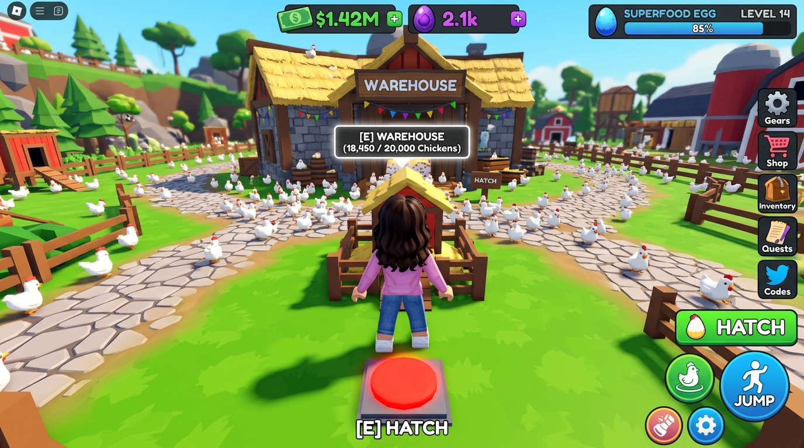
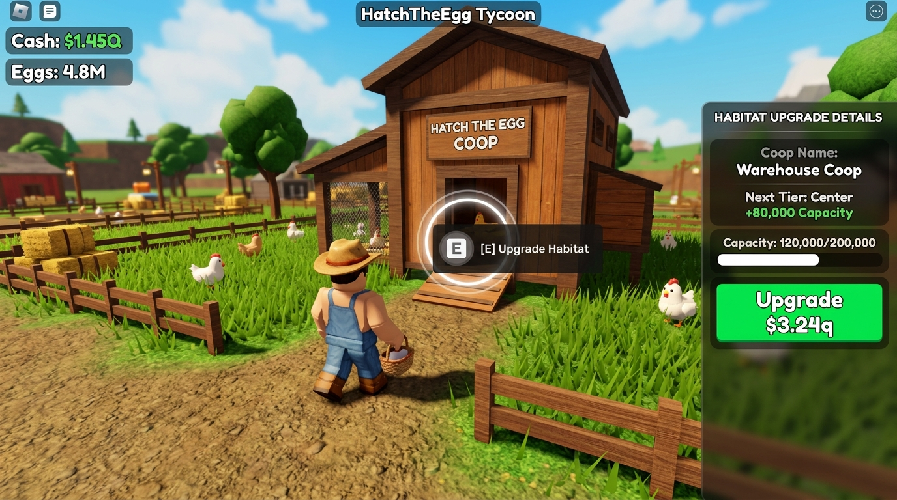
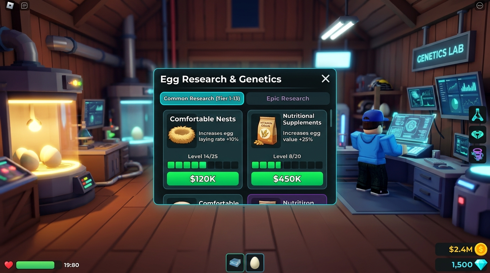

# Specyfikacja UI & Świata Gry 3D – HatchTheEgg (Roblox)

> **P — koncepcja UI i makiety, bez implementacji.** Układ, elementy produktów (MAX/VIP/pety), liczby i przykładowe ceny nie zatwierdzają zasad ekonomii. Źródło aktualnych reguł i statusów: [CURRENT_SPEC](../CURRENT_SPEC.md). Bilans pozostaje odłożony; makiety PNG zachowano bez zmian.

W Robloxie gracz **nie jest biernym obserwatorem z kamerą 2D z gry mobilnej**, lecz **bezpośrednio steruje swoim awatarem w świecie 3D (kamera z perspektywy trzeciej osoby – 3rd person)** i fizycznie porusza się po swojej działce farmy.

Interfejs musi łączyć **minimalistyczny HUD ekranowy** z **elementami diegetycznymi w świecie gry (In-World 3D UI / ProximityPrompts / BillboardGui)**, typowymi dla najlepszych symulatorów i tycoonów na platformie Roblox (*Pet Simulator*, *Lumber Tycoon*, *Restaurant Tycoon*, *Bee Swarm Simulator*).

---

## 1. Architektura Przestrzenna Działki Gracza (Farm Plot)

Każdy gracz na serwerze otrzymuje własną, modularną działkę 3D (Plot), na której znajdują się kluczowe punkty interakcji:

```
+---------------------------------------------------------------+
|                      [ PŁOT / DROGA PUBLICZNA ]               |
|                                                               |
|   [ SILOSY (x2-10) ]                   [ STACJA TRANSPORTU ]  |
|   (Fizyczne wieże z                   (Parking z pojazdami /  |
|    wskaźnikiem SurfaceGui)              stacja Hyperloop)     |
|                                                               |
|   [ KURNIK 1 ]                                 [ KURNIK 2 ]   |
|   (Parcela z 3D budynkiem)             (Parcela z 3D budynkiem)|
|            \                                   /              |
|             \====== [ ŚCIEŻKI KURCZAKÓW ] =====/              |
|             /                                   \              |
|   [ KURNIK 3 ]                                 [ KURNIK 4 ]   |
|   (Parcela z 3D budynkiem)             (Parcela z 3D budynkiem)|
|                                                               |
|                     [ GŁÓWNA WYLĘGARNIA ]                     |
|           +---------------------------------------+           |
|           |  Fizyczny Czerwony Przycisk Podłogowy |           |
|           |     (Pressure Plate / Step-On Pad)    |           |
|           +---------------------------------------+           |
|                                                               |
|   [ BUDYNEK BADAŃ ]                     [ AWATAR GRACZA 🏃 ]  |
|   (Terminal z komputerem /              (Biega swobodnie po   |
|    Szalony Kurczak NPC)                  całej farmie)        |
+---------------------------------------------------------------+
```

---

## 2. Punkty Interakcji w Świecie 3D (In-World Interactions)

### 2.1. Główna Wylęgarnia i Fizyczny Przycisk Wylęgu (The Hatch Pad)
* W centralnej części działki znajduje się wylęgarnia z **wielkim, podświetlanym czerwonym przyciskiem w podłodze (Pressure Plate / Floor Button)**.
* **Metody aktywacji przez awatara:**
  1. **Fizyczne wejście na przycisk:** Wejście awatara na przycisk ugina go pod stopami postaci z soczystym dźwiękiem "KLIK!" i uruchamia ciągły wylęg.
  2. **ProximityPrompt `[E]`:** Przytrzymanie klawisza `E` (lub dotknięcie na telefonie) przy wylęgarni.
  3. **Wygodny przycisk ekranowy:** Pływający przycisk na dole ekranu, pozwalający wylęgać kurczaki również wtedy, gdy awatar biega w innej części farmy.
* **Wizualny efekt wylęgu:**
  * Z bram wylęgarni wylatuje chmara uroczych, animowanych kurczaków low-poly, które biegną po kamiennych ścieżkach prosto do 4 kurników.
  * Awatar może biegać razem z kurczakami!

### 2.2. Parcele Kurników (Habitat Plots) & BillboardGuis
* Na farmie stoją 4 wyznaczone parcele budowlane.
* **Informacje przestrzenne w 3D:**
  * Nad każdym kurnikiem unosi się pływający wskaźnik `BillboardGui`:
    * Nazwa kurnika (np. *Warehouse*).
    * Pasek zapełnienia kurcząt (np. `18,450 / 20,000` kurczaków).
  * Przy wejściu do kurnika znajduje się świecący okrąg `ProximityPrompt`:
    * `[E] Rozbuduj Kurnik`.
* **Interakcja:**
  * Po wciśnięciu `E` nie zasłaniamy całego ekranu! Z prawej strony wysuwa się elegancka boczna szuflada (Side Drawer), gdzie gracz widzi statystyki ulepszenia i zielony przycisk zakupu, cały czas widząc swojego awatara i budynek w tle.

### 2.3. Budynek Badań (Research Lab / Terminal)
* Na farmie znajduje się futurystyczna stacja badawcza z holograficznym monitorem lub NPC ("Dr. Rooster").
* Podejście awatarem aktywuje prompt `[E] Otwórz Badania` (dostępne także pod skrótem klawiszowym `R` lub ikoną w HUD).
* Okno badań to półprzezroczysty, pływający panel typu holograficznego (hologram), który nie odcina gracza od świata gry.

### 2.4. Stacja Transportowa (Shipping Depot)
* Na skraju działki znajduje się parking i tory Hyperloop.
* Pojazdy gracza (od małego pickupa po pociąg Hyperloop) fizycznie stoją w dokach załadunkowych, a zsynchronizowane małe wózki ładują skrzynki z jajami.
* Podejście do kierownika transportu otwiera menu zakupu i dodawania wagonów do pociągów.

### 2.5. Silosy (Silos)
* Fizyczne wieże stojące w rogu działki.
* Na boku każdego silosu zamontowany jest cyfrowy wyświetlacz (`SurfaceGui`), który w czasie rzeczywistym pokazuje pozostały czas zasilania (np. `03:45:12`).

### 2.6. Drony w Przestrzeni Powietrznej 3D
* Drony nie są płaską grafiką 2D – to fizyczne modele 3D przelatujące po niebie nad głowami awatarów na różnych wysokościach!
* **Interakcja gracza:**
  * Gracz może kliknąć myszką / tapnąć palcem w drona na niebie.
  * Opcja "Roblox Fun": gracz może strzelać do dronów z procy (Slingshot tool) lub próbować podskoczyć z trampoliny na dachu kurnika!
  * Zestrzelony dron spada fizycznie na ziemię i rozsypuje wokół awatara skrzynki ze Złotymi Jajami lub gotówką.

---

## 3. Minimalistyczny HUD Ekranowy (Screen HUD)

Ponieważ gracz musi widzieć postać i swobodnie sterować kamerą (obrót myszą, zoom), ekranowy interfejs 2D jest zredukowany do niezbędnego minimum:

```
+-------------------------------------------------------------------------+
| [Jajo: Superfood]  [$1.42M +$24.5K/s]      [Farm Value: 68% ->]   [⚙️][🛒]|
|                    [🔥 5.4x Running Bonus]                              |
|                                                                         |
|                                                                   [🔬]  |
|                                                                   [🏠]  |
|                         [ WIDOK 3D ZZA PLECY AWATARA ]            [🚚]  |
|                                                                   [🌌]  |
|                                                                   [⚡]  |
|                                                                         |
| [Joystick Mobilny]                                      [ HATCH BUTTON ]|
|  (Tylko na telefonach)                                  [   SKOK / E   ]|
+-------------------------------------------------------------------------+
```

### 3.1. Górny Pasek (Top Status Bar)
* Płaska, zaokrąglona belka u góry:
  * **Aktualne Jajo:** Ikona jaja + Nazwa (kliknięcie otwiera podgląd ewolucji farmy).
  * **Gotówka ($ / Bocks):** Duża, czytelna kwota z formatowaniem `FormatNumber` (`$1.42M`).
  * **Wskaźnik zysku:** Mały zielony licznik na sekundę (`+$24.5K/s`).
  * **Pasek postępu Wyceny Farmy:** Informuje, ile jeszcze brakuje do kolejnego jaja.
  * **Running Chicken Bonus (RCB):** Płonący wskaźnik mnożnika (`🔥 5.4x`), który pojawia się i rośnie tylko wtedy, gdy kurczaki biegną po ścieżkach.

### 3.2. Prawy Pasek Narzędziowy (Quick Action Dock)
Pionowy pasek z okrągłymi ikonami:
* 🔬 **Badania (Research):** Skrót `[R]` na PC.
* 🏠 **Kurniki (Habitats):** Skrót `[H]` na PC.
* 🚚 **Transport (Depot):** Skrót `[T]` na PC.
* 🌌 **Prestiż (Prestige):** Skrót `[P]` na PC.
* ⚡ **Wzmocnienia (Boosts):** Skrót `[B]` na PC.

### 3.3. Dolny Prawy Róg (Action & Jump Button)
* Na PC spacja domyślnie służy do skoku, a trzymanie `[E]` lub klikanie przycisku wylęga kurczaki.
* Na urządzeniach mobilnych:
  * Po lewej stronie ekranu: wirtualny analogowy joystick do biegania postacią.
  * Po prawej stronie: przycisk skoku oraz duży, wygodny okrągły przycisk **"Hatch"** pod prawym kciukiem.

---

## 4. Porównanie: Gra Mobilna vs Adaptacja Roblox

| Cecha | Referencyjny HatchTheEgg (Mobile) | HatchTheEgg na Robloxie |
|---|---|---|
| **Perspektywa** | Statyczna kamera izometryczna 2D/pseudo-3D z góry | **Trójwymiarowy awatar gracza z kamerą TPP (3rd person)** |
| **Poruszanie się** | Brak – gracz tylko klika w interfejs | **Gracz biega awatarem po swojej parceli i farmie** |
| **Kurniki** | Menu z listą 4 pozycji | **4 fizyczne budynki na działce z promptami `[E]` i BillboardGui** |
| **Wylęg** | Trzymanie czerwonego kółka na ekranie | **Wchodzenie na wielki przycisk podłogowy lub trzymanie `[E]`** |
| **Badania** | Wielka lista zasłaniająca cały ekran | **Półprzezroczysty terminal holograficzny w laboratorium** |
| **Drony** | Płaskie sprajty 2D latające po ekranie | **Fizyczne modele 3D na niebie (można klikać lub strzelać)** |
| **Tryb wieloosobowy** | Pojedynczy gracz (kontrakty tylko w tabelce) | **Wspólny serwer: gracze widzą farmy sąsiadów i ich awatary!** |

---

## 5. Koncepcje Wizualne z Gry (3D Avatar & In-World UI)

### 5.1. Widok zza Pleców Awatara (3rd Person Gameplay)
Gracz biega swoim klockowym awatarem po farmie. Przed nim znajduje się fizyczna stacja wylęgarni z wielkim czerwonym przyciskiem `[E] HATCH` w podłodze, a wokół ścieżkami biegają setki kurczaków. Nad kurnikami unoszą się przestrzenne wskaźniki `BillboardGui`, a na ekranie widoczny jest tylko czysty, minimalistyczny HUD.



---

### 5.2. Fizyczna Interakcja z Kurnikiem (ProximityPrompt & Side Drawer)
Awatar podbiega do parceli kurnika, gdzie aktywuje się prompt `[E] Upgrade Habitat`. Zamiast zasłaniać cały ekran, z prawej strony wysuwa się półprzezroczysta karta z ulepszeniem, a gracz nadal widzi swoją postać i trójwymiarowy budynek.



---

### 5.3. Holograficzny Terminal Badawczy (Research Lab Terminal)
Awatar podchodzi do futurystycznej konsoli w stodole/laboratorium. Na ekranie pojawia się pływający, holograficzny interfejs badań technologicznych z podziałem na tiery, zachowujący widoczność awatara w tle z delikatnym efektem głębi ostrości.




---

## 6. Przyjazna dla Dzieci Stylistyka Wysp i Płytek Zakupowych (VIS-01–VIS-05)

W ramach realizacji zadań `VIS-01`–`VIS-05` (#37–#41) wdrożono generator świata 3D (`src/server/world/FarmPlotBuilder.luau`), prezentację kurcząt i dronów (`src/client/RoutePresentation.luau`) oraz responsywny HUD (`src/client/HUD.luau`), zachowując powyższą architekturę przestrzenną z lekkim, kolorowym wykończeniem dla młodszych graczy:
- **Archipelag wysp na wodzie z tęczą (`OceanWater` & `CentralHubAndIslands`):** Działka farmy znajduje się na słonecznej wyspie z piaszczystym brzegiem i jasnozieloną trawą z klasycznymi wypustkami Roblox (`Enum.SurfaceType.Studs`), otoczonej turkusową wodą z białymi falami. Drewniany most prowadzi na centralną wyspę z pomnikiem Złotego Jajka i wielką, 7-kolorową tęczą z chmurami.
- **Fizyczne płytki do kupowania (`Step-On Buy Pads`):** Obok tradycyjnych `ProximityPrompt`ów (`[E]`) i bocznych szuflad UI, przy 4 parcelach kurników, stacji transportowej i budynku badań umieszczono kwadratowe płytki podłogowe z wypustkami (`Studs`) oraz trójliniowym napisem `BillboardGui` (`FredokaOne` z obrysem). Wejście awatarem na płytkę pobiera z serwera `quoteId` (`GetPurchaseQuote`) i wywołuje ten sam autorytatywny zakup (`BuyHabitat`, `BuyVehicle`, `BuyResearch`) co kliknięcie w HUD.
- **Urocze modele 3D kurcząt (`RoutePresentation.luau`):** Kurczęta biegnące z wylęgarni (`(0, 0, 45)`) po czterech kanonicznych ścieżkach (`PRE-03`) są wieloczęściowymi modelami low-poly (korpus, czerwony grzebień, dziób, oczka, skrzydełka), które podskakują w trakcie biegu i wyzwalają efekt `ParticleEmitter` przy wejściu do kurnika (`CanCollide = false, CanTouch = false, CanQuery = false`).
