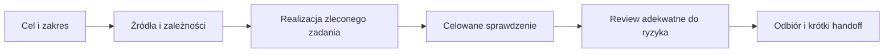

# Jeden workflow zadania HatchTheEgg

**P — propozycja procesu**, status i źródła w [README](README.md). Uprawnienia wynikają z rzeczywistego polecenia użytkownika i środowiska, nie z dawnego workflow GrowASnack ani z tego planu.

## Skills wspierające workflow

Procedury zadaniowe są w [katalogu skills](SKILLS_PLAN.md) i `.agents/skills/`. Dobierz skill według celu: plan, review, diagnoza, stan ekonomii/transakcje, Studio, wizualia lub matematyka. Nie stosuj wszystkich kolejno i nie traktuj ich jako zgody na wykonanie następnego etapu. Skille czytają tylko potrzebne referencje, a nie całość docs/ECC.

## 1. Start: cel i właściwe źródła

1. Przeczytaj bieżące polecenie, [WORKING_CONTEXT](../WORKING_CONTEXT.md) i [CURRENT_SPEC](../CURRENT_SPEC.md). Sprawdź [TODO](../TODO.md) w zakresie odłożeń; nie odtwarzaj całej historii.
2. Dobierz tylko źródła danego systemu. Mapa w kolejnej sekcji zastępuje wielokrotne skanowanie repo.
3. Rozróżnij N (referencyjne reguły obliczeń), S (referencyjne dane i tabele), R (zatwierdzona adaptacja), P (propozycja) i H (historia). Akceptacja zasad Roblox zastępuje w danym miejscu referencyjne zachowanie; nie przenosi statusu R na wszystkie liczby w sąsiednim raporcie.
4. Opisz wynik zadania, dozwolone pliki i najmniejszą potrzebną weryfikację. Krótka poprawka może mieć ten kontrakt w opisie zadania; osobny pakiet dokumentów nie jest obowiązkowy.

Nie ma jeszcze zatwierdzonego `v1_canonical/config/`, generatora Luau, wybranego ProfileStore ani runtime'u agentów HatchTheEgg. Odczyt dokumentacji referencyjnej jest użyciem opisanych danych, nie pozwoleniem na przebudowę materiałów roboczych albo utworzenie nowego cennika.

## 2. Mapa kontekstu — czytać według zadania

| Obszar | Materiał domenowy | Wsparcie techniczne ECC, tylko gdy potrzebne |
|---|---|---|
| Produkcja, FV, infrastruktura | [01](../01_upgrades_and_research.md), [02](../02_eggs_and_farm_value.md), [03](../03_habitats_and_population.md), [04](../04_vehicles_and_shipping.md) | [Architektura](../ecc/adaptations/hexagonal_luau_architecture.md), [referencje](../ecc/adaptations/reference_testing_and_verification.md) |
| SE i resety | [05](../05_prestige_soul_eggs_and_boosts.md), [13](../13_rewards_contracts_resets_and_gift_distributions.md), właściwe części [22](../22_gameplay_rules_for_approval.md) | Referencje + [zapis](../ecc/adaptations/datastore_migration_and_session_lock.md) |
| Offline, boosty, wydarzenia | [10](../10_verified_simulation_and_server_config.md), [12](../12_calendar_scaling_and_video_doubler.md), [16](../16_pet_stacking_offline_and_package_schedule.md), D04 w 22 | Architektura i kontrola czasu/operacji, bez ponownego otwierania ustaleń |
| Pety i łączenie | D01–D03 w [22](../22_gameplay_rules_for_approval.md), aktualizacja [23](../23_pet_fusion_acceptance_review.md), [25](../25_approved_product_structure.md), [26](../26_approved_launch_scope_and_pro_availability.md) | Referencje + zapis, tylko niezbędny zakres |
| Prezenty i monetyzacja | D04/D05/D07 w 22, [24](../24_doubler_and_bonus_gift_acceptance_review.md), [25](../25_approved_product_structure.md), [26](../26_approved_launch_scope_and_pro_availability.md) | [Bezpieczeństwo](../ecc/adaptations/server_validation_and_security_checklist.md), zapis i [błędy](../ecc/adaptations/error_handling_and_result_pattern.md) |
| Kalendarz/trofea | [13](../13_rewards_contracts_resets_and_gift_distributions.md), [15](../15_calendar_gameplay_formula_and_roblox_scope.md), D06/D07 w 22 | Te same zasady trwałego rozliczenia; bez kolejnej rundy audytu modelu referencyjnego |
| Świat/UI | [makiety](../ui/ui_design_specification.md) jako P + konkretne wymaganie użytkownika | Plan wizualny i ograniczona ocena sceny; nie dziedziczyć wyglądu GrowASnack |

Docs opisują znaczenie, JSON-y wyników dostarczają rzeczywistych wejść i oczekiwanych wartości. Nie testować dochodu jako FV: to różne wielkości. Przywołanie raportu N z kontrolowanymi wejściami nie dowodzi wszystkich stanów systemu.

## 3. Zakres i autonomia

| Rodzaj pracy | Jak postępować |
|---|---|
| Dokumentacja/plan | Zrealizuj zlecony zakres. Nie uruchamiaj kodu gry, Studio ani instalacji z samego planu. |
| Implementacja zatwierdzonej reguły | Dopiero po zleceniu implementacji. Dobierz zwykłe rozwiązania techniczne samodzielnie; istotne decyzje zapisz w ADR, nie pytaj o każdą nazwę modułu. |
| Bug | Odtwórz najmniejszy przypadek, wskaż rozbieżność z właściwym źródłem, napraw w przyznanym zakresie i zweryfikuj. |
| UX | Weryfikuj dotknięte zachowanie i czytelność; zmiana wyglądu nie uruchamia automatycznie całej symulacji progresji. |
| Zmiana produktu lub zatwierdzonego zachowania | Przygotuj konkretny wariant i wskaż różnicę; bez samodzielnego zmieniania R. Zatrzymaj tylko zależną część zadania. |
| Bilans | Pozostaje odłożony. Nie ustalaj cen, slotów, sił, procentów/receptur/progu gwarancji, podaży VD lub inkubacji i nie wznawiaj symulacji. |
| Migracja istniejących danych | Projektuj w granicach D07, wskaż zgodność wersji i odwracalność. Destrukcyjna zmiana danych wymaga właściwej autoryzacji, nie domyślnego odziedziczenia zgód z innego projektu. |

Nie wymuszamy klasyfikacji „dokładnie jeden typ”: zadanie może być np. bugiem z ryzykiem transakcji. Wystarczy etykieta celu i wskazanie istotnego ryzyka. Czytanie historii w celu ustalenia pochodzenia nie wymaga nowej zgody samo w sobie i nie awansuje historii do reguł bieżących.

## 4. Cykl małego zadania

- **Zaplanowane:** cel i zależności, bez twierdzenia o wykonaniu.
- **W realizacji:** praca w przyznanym zakresie.
- **Do review:** istnieje konkretny wynik i raport wykonanych/pominiętych kontroli.
- **Wymaga poprawy:** konkretne ustalenia review, bez kasowania nieudanych prób.
- **Zweryfikowane w zakresie:** kryteria tego zadania sprawdzono na wskazanej wersji; nie oznacza gotowości całej gry lub publikacji.
- **Przyjęte przez użytkownika:** tylko jeżeli rzeczywiście nastąpiła taka akceptacja; nie wyprowadzać jej z milczenia lub technicznego PASS.

Nie wdrażamy teraz automatu tych stanów ani folderów dla każdego mikro-zadania. Szablony stosować proporcjonalnie: [TASK_TEMPLATES](TASK_TEMPLATES.md).

## 5. Weryfikacja i review

| Dowód | Do czego wystarcza | Czego nie dowodzi |
|---|---|---|
| Odczyt / kontrola docs | Statusy, odnośniki, zakres zmian | Działanie przyszłego Luau |
| Zapisane wyniki modelu referencyjnym / analiza matematyczna | Źródłowe wartości i reguły w udokumentowanych przypadkach | Wykonanie nowego modułu Roblox |
| Uruchomiony Luau | Logika pod faktycznym runnerem i jego kontrolowanymi zależnościami | Sieć i trwałość chmury, jeżeli były mockowane |
| Studio lokalne | Rzeczywiste zachowanie objęte testem, wskazana liczba klientów/serwerów | Prawdziwa wieloserwerowa trwałość, jeśli nie użyto chmury |
| Izolowane DEV / chmura | Wykonane przypadki API i współbieżności w danym środowisku | Cała produkcja i subiektywna jakość gry |
| Playtest człowieka | Wrażenia i ergonomia obserwowane przez człowieka | Wszystkie nieobserwowane ścieżki ekonomii/zapisu |

Autor wykonuje dostępne, właściwe testy i self-review. Przy zmianach sald, zapisu, nagród, resetów, łączenia i płatności planujemy dodatkowe niezależne review przed uznaniem takiego zakresu za gotowy do wydania. Niezależny reviewer jest read-only względem ocenianej implementacji, ale może uruchomić uzgodnione testy w bezpiecznym środowisku. Jeśli niezależnego review nie wykonano, status to jawnie „review nie wykonano”, nie fikcyjna akceptacja. Nie tworzy to automatycznego uprawnienia do wysyłania zadań innemu modelowi.

Nie ma obowiązkowego konkretnego modelu ani osobnego audytora dla każdej poprawki. Dla dokumentacji i niskiego ryzyka wystarcza kontrola adekwatna do zmiany. Przygotowanie planu nie uruchamia subagentów; delegacja następuje tylko przy autoryzacji użytkownika i dostępnych możliwościach środowiska.

Testy muszą obejmować zmienione zachowanie i istotne granice. Tolerancję dobierać do pola i referencyjnej konwersji; nie narzucać jednego epsilon dla wszystkich FV/SE/GE. ID i liczniki nie stają się bezpieczne przez samo wprowadzenie BigNum. Nie tworzyć referencji z wyniku testowanej funkcji.

Po przejściu celowanych kontroli rozszerzaj regresję tylko przy zmianie interfejsów, integracji etapu lub nowym ryzyku. Nie ma stałej reguły „3/12 paczek”, minimum 20 terminów, 3 zatwierdzonych ADR ani 80% pokrycia. Jeśli testu nie ma albo nie można go uruchomić, zapisz tę granicę; nie nazywaj jej PASS i nie fabrykuj komendy.

## 6. Wersja plików, integracja i Studio

- Zapisz identyfikację ocenianych plików: commit, jeśli jest dostępny, albo lista SHA256. Zmiana ocenianego pliku unieważnia wnioski dotyczące starej wersji. Ocena pakietu nie zastępuje kontroli jego integracji z pozostałymi zmianami.
- Przy rzeczywistej równoległej pracy jeden właściciel danego zakresu, brak nakładających się zapisów; izolacja checkoutów pomaga, ale nie usuwa konfliktu logicznego. Nie kopiować całego starego checkoutu na bieżący projekt.
- Studio ma jednego wykonawcę na instancję/czas testu. Nie zatrzymuj cudzej gry ani playtestu użytkownika. Zidentyfikuj właściwą instancję, testowane pliki i tryb zapisu; po własnym teście usuń swoje fixture i oddaj zasób w uzgodnionym stanie. Nie istnieje jeszcze mechanizm lease HatchTheEgg — nie udawaj jego działania.
- Nie używaj identyfikatorów place/universe, DataStore lub prefiksów z GrowASnack. Dla HatchTheEgg środowisko DEV i namespace trzeba dopiero wybrać w ramach przyszłego zlecenia. Nie publikuj, nie twórz produktów, nie wydawaj Robux i nie zmieniaj kont/produkcji z samego workflow.
- Git i GitHub podlegają poleceniu użytkownika i realnym instrukcjom repo. Nie zakładamy brancha `develop`, automatycznego push, zamykania issues ani prawa do zmiany zdalnego repo odziedziczonego ze źródła.

## 7. Zakończenie i brak postępu

Podaj wynik, zakres dowodów, pozostałą konkretną lukę i następny krok. Domyślne statusy szablonu są „nie wykonano / nie sprawdzono”. Nie powielaj raportów między TODO, kontekstem i planem — krótki link wystarcza.

Jeśli kolejne próby nie dostarczają nowego dowodu, zbierz minimalną reprodukcję, oczekiwane zachowanie i dotychczasowe wyniki, zamiast powtarzać te same działania. Nie przyjmujemy sztywnego limitu dwóch prób ani wymogu zatrzymania całej pracy; zatrzymaj zależną część, kontynuując zlecone niezależne zadania.

Nie dopisuj kolejnego przeglądu zamkniętych ustaleń tylko dlatego, że brakuje przyszłego testu integracyjnego. Raporty ECC i GrowASnack są wsparciem procesu, nie nadrzędną specyfikacją HatchTheEgg.

## Kontrakt liczb, czasu i profilu

Przy planowaniu adapterów, zapisu lub symulacji czytaj [kontrakt 27](../27_numbers_time_and_player_state_contract.md) obok właściwego źródła domenowego. Status P dotyczy proponowanych formatów/pól, a R nadal rozstrzyga reguły gry. Referencje i bilans nie zostały zmienione. Pomocnicze review koncepcji nie zastępuje sprawdzenia przyszłego kodu.

## Kontrakt modułów i komunikacji

Dla zmian na granicy serwer/klient użyj [28](../28_modules_and_client_server_contract.md) wraz z 27 i właściwą domeną. Nie traktuj snapshotu jako pełnego profilu ani wyniku operacji jako delty salda. Wcześniejsze przykłady ECC nie nadpisują semantyki replay, statusów PENDING/UNKNOWN i wersji widoku. Dokument P nie uruchamia implementacji lub zdalnych operacji.

W przyszłej realizacji sprawdź także scenariusze 28 dotyczące quoteId dla zakupów, NOT_ACCEPTED wobec PENDING i utraty kolejki oraz przygotowania zamówienia prezentu Robux oddzielonego od jego wypłaty. Stary manifest module_protocol_verification.json jest snapshotem utworzenia dokumentu, nie sumą kontrolną późniejszych redakcji; korektę opisuje [weryfikacja uzupełnienia](module_protocol_supplement_verification.json).

## Plan pierwszego zakresu

Dla zadania podstawowej farmy czytaj [29](../29_first_farm_implementation_plan.md), następnie tylko wskazane źródła domenowe. Podział F01–F09 jest planem P z zależnościami, nie automatyczną delegacją lub zgodą na realizację. A01–A16 oddzielają dowód lokalny, Studio, rzeczywisty zapis i ocenę człowieka. Pierwszym możliwym osobnym zleceniem jest dokumentacyjny F01, bez instalacji i zmian bilansu. Nie przenoś statusu REFERENCE_ONLY na konfigurację produkcyjną i nie traktuj neutralnego środowiska testowego jako pełnej obsługi zapisów graczy z aktywnymi efektami.
